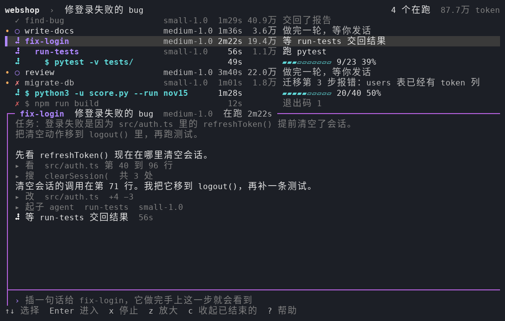
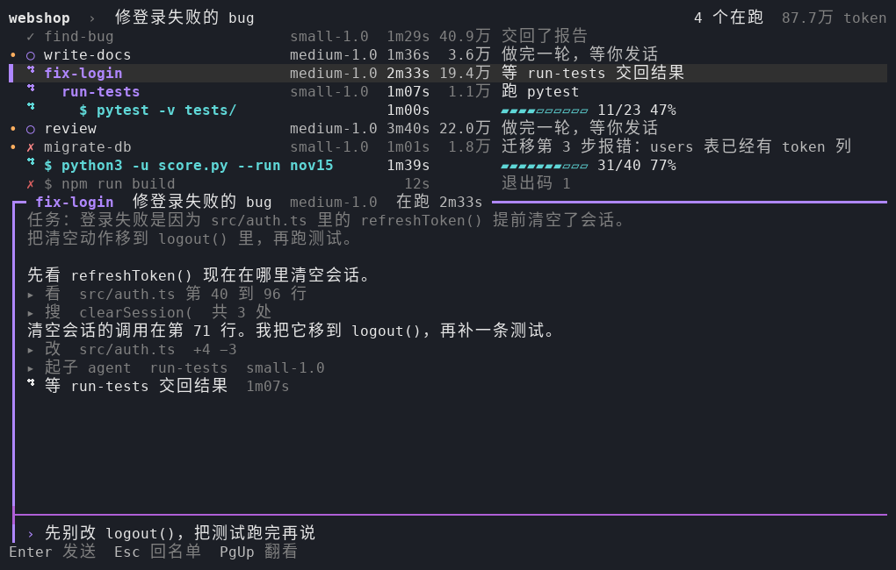
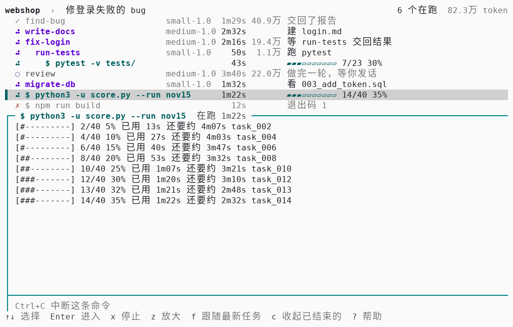

# copilot-panes

[](https://github.com/zhanglongtu/copilot-panes/actions/workflows/ci.yml)
[](LICENSE)

copilot-panes is a terminal tool that sits in a tmux pane next to GitHub Copilot CLI and keeps showing its sub-agents and background shell commands. You can read their live output, send a message to a sub-agent and interrupt a command. It needs Linux, tmux, Node.js 22.18 or newer and GitHub Copilot CLI. The interface and the documentation are in Chinese. This is a personal project, not an official GitHub product.

## 这是什么

copilot-panes 在 tmux 的一个 pane 里，一直显示旁边那个 GitHub Copilot CLI 当前 session 的子 agent 和后台命令。Copilot CLI 自带的 `/tasks` 面板不能常驻，要看就得停下手上的事；这个工具放在旁边，随时能看它们在做什么，给子 agent 发消息，像看终端一样看命令的输出，也能中断命令。

## 界面长什么样

焦点在名单：



焦点在内容区，正在给子 agent 发消息：



浅色终端：



怎么读这个界面：

- **亮度**表示死活：在跑的最亮，等你发话的暗一档，结束的最暗。颜色只表示种类：紫色是子 agent，青色是命令（以 `$` 开头），只有活着的条目才带色。
- **选中的那一行**整行铺底色。行首的橙色 `•` 表示它结束了或在等你发话，你还没看过。
- **内容区是半框**：上边是带标题的横线，左边是竖线。框的颜色说明键盘输入发给谁，粗线表示焦点在内容区，细线表示在名单。
- **符号**：转动的点是在跑，`○` 做完一轮、等你发话，`✓` 已结束，红色 `✗` 失败，`⊘` 已取消，`◌` 随 session 结束而停。

## 需要什么

- Linux。界面和中断命令要读 `/proc`，不支持 macOS 和 Windows。
- tmux。测过 3.4。
- Node.js 22.18 以上。
- GitHub Copilot CLI。测过 1.0.112。给子 agent 发消息、停止条目、中断命令靠装进 Copilot CLI 的扩展，它是实验功能，接口可能随版本变化。没有扩展时界面仍能用，只是只读。

## 安装

```sh
git clone https://github.com/zhanglongtu/copilot-panes.git
cd copilot-panes
npm ci
npm run build
```

`npm run build` 生成 `dist/copilot-panes.mjs`（界面）和 `dist/extension.mjs`（扩展）。让 `copilot-panes` 命令可用：运行 `npm link`，或建一个符号链接（`~/.local/bin` 要在 `PATH` 里）：

```sh
ln -s "$PWD/dist/copilot-panes.mjs" ~/.local/bin/copilot-panes
```

然后装扩展：

```sh
copilot-panes install
```

它把 `extension.mjs` 复制到 `$COPILOT_HOME/extensions/copilot-panes/extension.mjs`（`COPILOT_HOME` 没设时是 `~/.copilot`）。目标文件已经存在且内容不同时，先备份成 `extension.mjs.bak-年月日-时分秒`。加 `--dry-run` 只说会做什么。

接着：

1. 在 Copilot CLI 里运行 `/settings experimental on`（已经开了就跳过）。
2. 重新启动 Copilot CLI，扩展随它启动。
3. 运行 `copilot-panes doctor`。它逐项检查 tmux、实验功能、扩展文件、session 和扩展的连接，每个 `✗` 后面写着怎么修。

以后重新构建后，要再运行一次 `copilot-panes install`；`doctor` 会提示扩展版本不一样。

## 使用

在 tmux 里把窗口分成左右两个 pane（默认 `Ctrl+b %`）：左边运行 `copilot`，右边运行 `copilot-panes`。

**它怎么找到 session。** 按这个顺序：

1. 命令行给了 `--session <ID>`，就只看它。ID 可以只写前几位，能唯一认出就行。
2. 在 tmux 里，选同一个窗口里其他 pane 的 Copilot CLI。
3. 不在 tmux 里，或同一窗口里没有，选工作目录和界面相同的。
4. 都没有，显示等待画面，每秒找一次。

**一个 Copilot CLI 开着多个 session**（用过 `/new`）时，界面显示你正看着的那个：先看 Copilot CLI 进程日志里最后切到的 session，再看 pane 标题，都没有就选你最近发过言的。你在左边切了 session，右边几秒内跟过去。按 `s` 手选的会固定下来，列表最后一项“恢复自动选择”取消固定。

**只读。** 扩展没连上时，界面只读：名单和子 agent 的过程照常显示，命令的输出要等命令结束才有；不能发消息、停止、转后台和中断。顶行下面有一行橙色提示写明原因，恢复办法如下：

| 提示 | 怎么恢复 |
| --- | --- |
| 正在连接扩展… | 等几秒；超过 3 秒会变成“连不上扩展” |
| 还没装扩展；扩展和界面的版本不一致 | 运行 `copilot-panes install`，再重启 Copilot CLI |
| 实验功能没开 | 在 Copilot CLI 里运行 `/settings experimental on`，再重启 |
| 这个 session 启动时还没装扩展 | 对它说“重新加载扩展”，或重启 Copilot CLI |
| 连不上扩展、扩展没能开成连接 | 重启 Copilot CLI；运行 `copilot-panes doctor` 看原因 |
| 扩展的连接没通过安全检查 | socket 或它的目录不属于你、别人能写，或对端进程号和登记记录不符。检查 `~/.copilot/copilot-panes/sessions/` 的属主和权限 |

**演示。** `copilot-panes --demo` 不需要 Copilot CLI，用内置的样本数据运行，适合先看界面、试按键；演示里的操作只改演示数据。

## 按键

按 `?` 看全部按键。名单里：

| 键 | 作用 |
| --- | --- |
| `↑` `↓`、`j` `k` | 选上一个、下一个条目 |
| `Home` `g`、`End` `G` | 选第一个、最后一个条目 |
| `Enter`、`→`、`Tab` | 进入内容区 |
| `PgUp` `PgDn` | 不进入内容区，直接翻看内容 |
| `x` | 停止选中的条目；2 秒内按两次才执行 |
| `b` | 把选中的前台命令转到后台 |
| `c` | 收起、展开已结束的条目 |
| `f` | 开关“跟随最新”：新起的条目自动选中 |
| `z` | 放大内容区，再按恢复 |
| `s` | 换 session，或恢复自动选择 |
| `/`、`n`、`N` | 搜索选中条目的内容，Enter 确定；`n`、`N` 跳到下一处、上一处 |
| `y`、`o` | 复制全文到 tmux 缓冲区；用 less 打开全文 |
| `e` | 展开、收起细节：完整的任务说明、工具结果，命令的原文 |
| `q`、`Ctrl+C` | 退出；`Ctrl+C` 要按两次 |

子 agent 的内容区里：

| 键 | 作用 |
| --- | --- |
| `Enter` | 发送消息，它做完手上这一步就会看到 |
| `Ctrl+J`、`Alt+Enter` | 输入框里换行 |
| `Esc` | 回名单（这里 `/` 是普通文字，要搜索先回名单） |
| `PgUp` `PgDn` | 翻页 |
| `↑` `↓`、`Home` `End` | 光标在输入框第一行按 `↑`、最后一行按 `↓` 时翻看一行；输入框是空的时，`Home` `End` 翻到最前、最后 |
| `Ctrl+C` | 清空输入框；输入框是空的时提示“按 Esc 回名单” |

命令的内容区里：

| 键 | 作用 |
| --- | --- |
| `Ctrl+C` | 中断，按一次升一级（见“中断命令”一节） |
| `Esc` | 回名单 |
| `↑` `↓`、`PgUp` `PgDn`、`Home` `End` | 翻看 |
| `/`、`n`、`N`、`y`、`o`、`e` | 同名单里 |

鼠标：点名单的一行选中它，点内容区进入，滚轮翻看。

## 中断命令

在命令的内容区里按 Ctrl+C，界面直接给命令的进程（是进程组组长时发给整个进程组）发信号，不经过 Copilot CLI。第一次发 SIGINT，和在终端里按 Ctrl+C 一样；3 秒之内再按不发，提示行写还要等几秒；3 秒之后再按发 SIGTERM，再按发 SIGKILL。命令忽略了 SIGINT（比如写了 `trap "" INT`）的，要等到 SIGTERM 才停，实测退出码 143。找不到进程号，或者进程已经不属于这个 Copilot CLI 时，界面改请扩展让 Copilot CLI 取消这条命令，效果和名单里的 `x` 一样。

中断不了或者只能中断一部分的情况：

- 命令里用 `&` 起的后台子进程会忽略 SIGINT，Ctrl+C 停不了它们。
- 用 `detach: true` 起的命令：只发 SIGINT 实测停不了，所以界面直接请 Copilot CLI 取消（提示行写“已请求停止”）。它结束后没有退出码。
- pytest、npm 这类真实命令能不能被 SIGINT 停下，没测过。停不下来就用 `x`。

**为什么不能给命令打字。** 后台命令的标准输入是 `/dev/null`，也没有伪终端，谁都没法给它输入。在命令的内容区按字符键，界面只提示“这条命令不接受输入，只能中断”。

## 命令行选项

```
copilot-panes [选项]      运行界面
copilot-panes install     把扩展装到 $COPILOT_HOME/extensions/copilot-panes/
copilot-panes doctor      检查实验功能、扩展、tmux 和找到的 session
```

| 选项 | 作用 |
| --- | --- |
| `--session <ID>` | 只看这个 session，ID 可以只写前几位 |
| `--session-state-dir <目录>` | Copilot CLI 的 session 目录，默认 `$COPILOT_HOME/session-state` |
| `--data-dir <目录>` | 运行时数据目录，默认 `$COPILOT_HOME/copilot-panes` |
| `--light`、`--dark` | 浅色或深色配色，默认问终端背景色，问不到用深色（环境变量 `COPILOT_PANES_THEME`） |
| `--no-bell` | 有条目失败时不响铃 |
| `--demo` | 用内置的样本数据运行，不需要 Copilot CLI |
| `--dry-run` | 只对 `install` 有用：只说会做什么，不改文件 |
| `--version`、`--help` | 打印版本号、打印说明 |

## 常见问题

**一直显示等待画面。** 确认 Copilot CLI 在同一个 tmux 窗口的另一个 pane 里，或工作目录相同；都不满足时用 `--session <ID>` 指定。

**颜色不对。** 浅色终端加 `--light`。不加时，界面依次看环境变量 `COPILOT_PANES_THEME`、终端背景色、环境变量 `COLORFGBG`，都没有就用深色。

**符号对不齐。** 界面按 tmux 3.4 实测的字符宽度排版。换一个有 `⠋`、`○`、`✓`、`┃` 的等宽字体；仍然错位，多半是终端或 tmux 版本对这些字符的宽度不同。

**顶行写“session 已结束”。** Copilot CLI 被强行结束、来不及写结束记录。还在跑的条目标成“已停”（`◌`），不能再发消息；重新打开 Copilot CLI 后，界面约 1 秒接上新的 session。

**`y` 或 `o` 不生效。** 不在 tmux 里时，`y` 用终端的 OSC 52（让终端自己写剪贴板的控制码）写剪贴板，终端不支持就复制不到。`o` 在 tmux 里要 `display-popup`（tmux 的弹窗命令）和一个连着这个 tmux 的客户端。

## 开发

构建、测试、部署和真实联调的办法见 [docs/development.md](docs/development.md)。

## 许可

MIT，见 [LICENSE](LICENSE)。本项目是个人项目，和 GitHub 没有关系；“GitHub Copilot”是 GitHub 的商标。

## 相关阅读

- [docs/architecture.md](docs/architecture.md)：扩展和界面怎么分工，数据怎么流动，几条关键规则。
- [docs/design.md](docs/design.md)：界面的视觉规则：颜色表、每种状态的样式、内容区的半框。
- [docs/development.md](docs/development.md)：目录结构、测试、构建、部署、真实联调、截图。
- [docs/notes/events-log.md](docs/notes/events-log.md)：事件日志里的事件，以及名单怎么从它们得出。
- [docs/notes/extension-api.md](docs/notes/extension-api.md)：Copilot CLI 扩展接口的实测行为。
- [docs/notes/processes-and-sessions.md](docs/notes/processes-and-sessions.md)：命令进程的样子、信号的效果、哪个 session 在前台。
